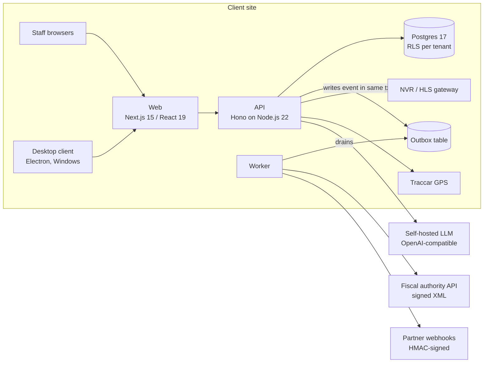

# Verto

A business system for Albanian companies that grows from a CRM into a full ERP: accounting, sales, inventory, HR, fiscalization and operations in one Albanian-language product.

**Status:** pilot deployment, running on-premises at its first client (a hospitality complex). Actively developed.

> Code is private (client work). This repository is a case study.

---

## The problem

Small and mid-sized Albanian businesses typically run on a patchwork: a desktop accounting package, a separate fiscal-receipt tool, spreadsheets for stock and payroll, and nothing that connects them. Most software on the market is either translated foreign ERP that ignores the Albanian chart of accounts, VAT and fiscalization rules, or a single-purpose local tool.

## What Verto does

Verto is **one product on two axes**:

| | Self-serve | Managed |
|---|---|---|
| **Verto CRM** (lighter tier) | clinics and service businesses manage clients, appointments, invoices | |
| **Verto Business / ERP** (full tier) | | the whole company runs on it, installed and operated by Z.E Digital Tech |

What a business gets on the ERP tier:

- **Accounting** – double-entry ledger on the Albanian chart of accounts (seeded automatically for each new company), balance sheet, P&L, trial balance, general ledger, cash flow and forecast, budget vs actual, AP/AR aging, bank reconciliation with statement import, fixed assets with monthly depreciation, multi-currency with FX snapshots, Albanian VAT return.
- **Sales and procurement** – quotes, sales orders, invoices, recurring invoices, credit notes, purchase orders with approval, goods receipts, supplier-invoice OCR (PDF text or Tesseract on scans).
- **Inventory** – stock movements with weighted-average valuation, lot and serial tracking with expiry, reservations, landed cost, stock counts, reorder alerts; COGS posted to the ledger automatically on tracked sales.
- **Point of sale and verticals** – POS checkout that posts its own journal entries, plus vertical modules for hospitality and retail operations.
- **Fiscalization** – Albanian e-invoice and cash-register fiscalization implemented to the published technical specification (tested against the official sandbox; production certificate pending).
- **HR and payroll** – departments, employees, contracts, leave accrual and payroll with Albanian rules, timesheets, reviews, recruitment.
- **Manufacturing** – multi-level bills of materials, work orders, material issue and completion, MRP, quality holds and scrap, production costing posted to the GL.
- **Operations** – CCTV live view (NVR integration through an HLS gateway) and vehicle GPS (Traccar integration) inside the same app.
- **AI assistant** – staff ask questions in Albanian; answers are grounded in the product's own manuals and served by a self-hosted LLM (see [gb10-inference](https://github.com/ezekaj/gb10-inference)).
- **Extensibility** – custom fields, a forms designer, an event-triggered workflow engine, signed outbound webhooks, scoped app credentials, an OpenAPI 3.1 spec and a TypeScript SDK.

Every user-facing string is in Albanian.

## Architecture

A modular monolith: one API process, one web app, one background worker, one Postgres. Business domains are bounded contexts that own their own Postgres schema and are written to be extractable later.

Bounded contexts (`identity`, `party`, `ledger`, …) each own a schema; no cross-schema reads, communication through events or APIs. Side effects that leave the system (fiscal submissions, webhooks, workflow actions) are written to an **outbox in the same transaction** as the business change and delivered by the worker, so a crash never leaves an invoice saved but unsubmitted, or submitted twice.

### Deployment model: one instance per client

Each client gets an **isolated instance**: its own machine or container stack, database, secrets and fiscal certificate. This is forced by the fiscal rules (one certificate signs for one tax ID), and it means one client's failure or breach cannot touch another's. Two paths are supported:

- **Docker Compose** (Postgres, API, worker, web, Caddy with automatic TLS) for Linux hosts.
- **Native Windows services** for sites where a Windows PC is the only server. The web app is built on a Windows CI runner with a flat `node_modules` (no symlinks) and shipped as a tarball, because pnpm's symlinked trees do not survive a cross-platform copy and Windows path limits break zip tools.

A vendor control plane lets Z.E Digital Tech suspend or reactivate an instance (writes blocked with a clear message, reads and export kept open) without a redeploy.

## Stack

TypeScript end to end · Node.js 22 · Hono · Next.js 15 / React 19 · PostgreSQL 17 · pnpm + Turborepo monorepo · Vitest + Playwright · Electron (Windows desktop client) · Docker Compose + Caddy · GitHub Actions.

## Notable engineering decisions

- **Tenant isolation in the database, not only in code.** Every tenant table has `FORCE ROW LEVEL SECURITY`. The app connects through a role that cannot bypass RLS and switches to it per transaction with `SET LOCAL ROLE`, so a missing `WHERE tenant_id = …` in application code still cannot leak another tenant's rows. Cross-tenant HTTP tests run in CI.
- **The ledger enforces its own invariants.** Journal entries are immutable, balance (debits = credits) is enforced by the database, and closed fiscal periods are locked by triggers so nothing can be back-dated, whichever code path tries.
- **Fiscal signing from the specification.** The invoice identification code is built exactly as specified (seven fields joined, RSA-SHA256 signed, MD5 fingerprint of the signature), and messages use enveloped XMLDSig with exclusive C14N. A guard refuses to sign if the certificate's tax ID does not match the tenant's: the invoice is saved unfiscalized rather than signed with the wrong identity.
- **A silent-failure bug found before it shipped.** Running the production stack end to end showed the outbox worker failing on every event (a `BigInt` id that `JSON.stringify` cannot serialize) while a bare `catch` counted failures without logging them. It would have looked healthy and never fiscalized. Fixed at the root, and failures now log and back off instead of spinning silently.
- **Self-hosted AI with fail-closed behaviour.** The assistant calls an OpenAI-compatible endpoint on our own hardware, with a per-tenant daily cap on top of a per-minute rate limit. If the model is unreachable the API returns a clear error instead of an invented answer. The assistant's knowledge is generated from the same Albanian manuals used for on-site training, so docs and answers cannot drift apart.
- **Security basics as defaults.** argon2id passwords, 32-byte session tokens stored only as SHA-256 hashes, TOTP, CORS allow-list, per-IP rate limits, CSP/HSTS/`X-Frame-Options: DENY`, body-size limits, audit log on every mutation, SSRF guard on outbound webhooks, soft deletes, GDPR export and erasure.

---

Code is private (client work). Built by **Z.E Digital Tech** — [zedigital.tech](https://zedigital.tech) · elvizekaj@zedigital.tech
